# Especificacao e Planejamento do MVP: Plataforma Artificio

**Sistema:** Artificio (Catalogo de Comissoes e Portfolios para Artistas e Clientes)  
**Equipe:** Anna Letycia, Cristiano Silveira, Eduardo Rolim, Luan Diniz  
**Disciplina:** Engenharia de Software Seguro  
**Objetivo do documento:** Mapear a arquitetura, regras de negocio e funcionalidades do MVP atraves de diagramas Mermaid, detalhando cada operacao do sistema sem inclusao de codigo-fonte nesta etapa de documentacao.

---

## 1. Visao Geral da Arquitetura Web

O Artificio será desenvolvido como uma aplicacao web tradicional em camadas, utilizando Spring Boot MVC e renderizacao server-side com Thymeleaf. O fluxo de requisicoes, controle de sessoes e protecao de rotas ocorre inteiramente no servidor.

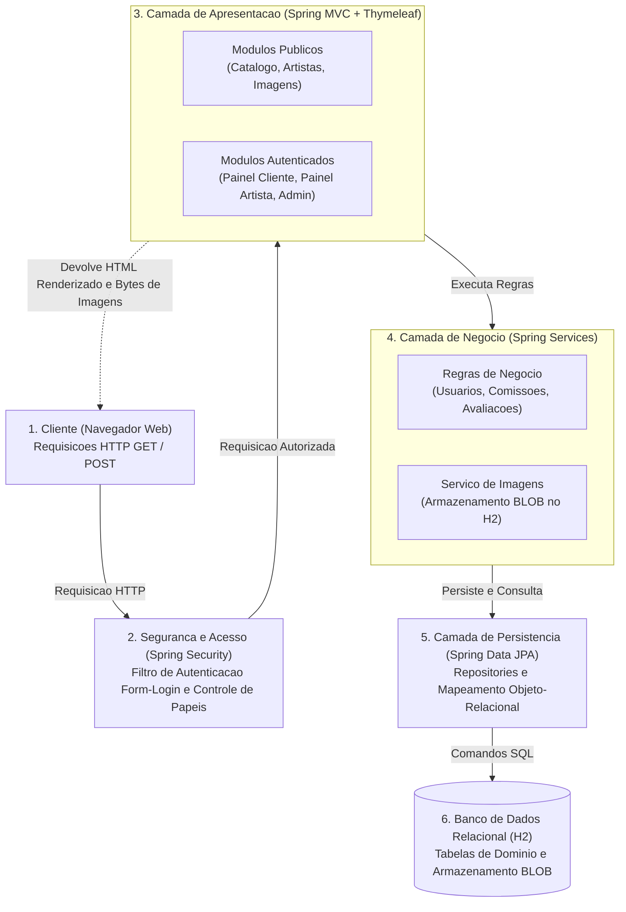

---

## 2. Armazenamento de Imagens em BLOB no H2

Para o MVP, o armazenamento das imagens das obras de portfolio e perfis sera feito diretamente como **BLOB (Binary Large Object)** no banco de dados H2 atraves da entidade `ImagemBlob`. Dessa forma, todo o ambiente de desenvolvimento roda de forma auto-contida em memoria/banco local, sem necessidade de configuracao de pastas no sistema de arquivos.

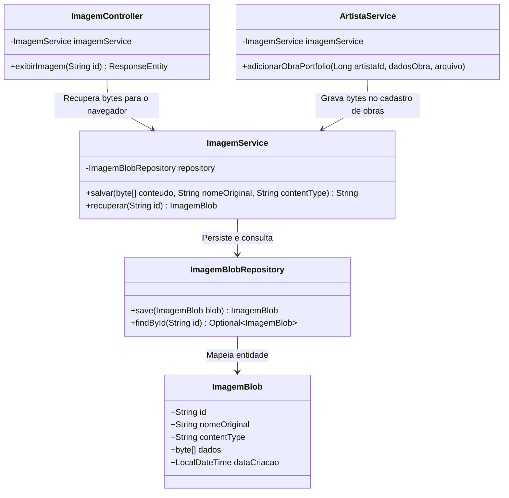

### Fluxo Operacional de Upload e Exibicao de Imagens

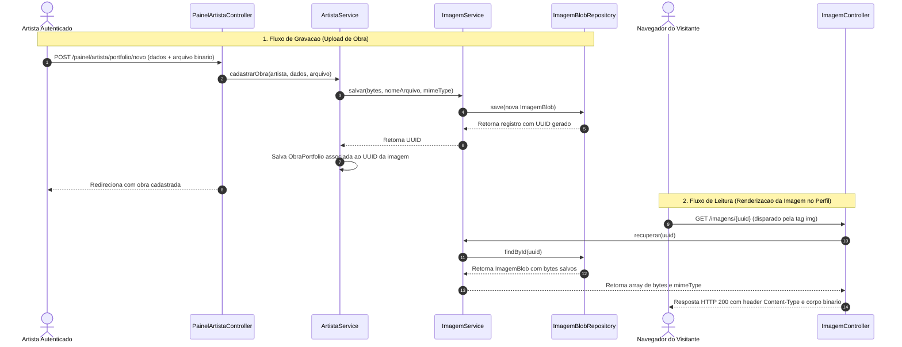

---

## 3. Diagrama de Casos de Uso Global (UML)

Mapeamento completo dos atores e das funcionalidades disponiveis no MVP do sistema:

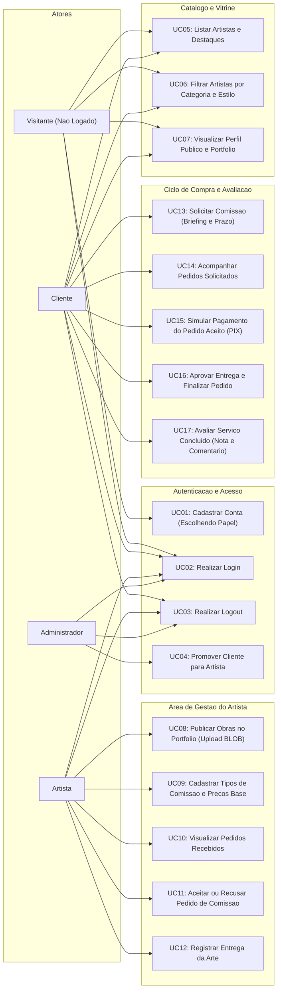

---

## 4. Diagrama de Classes de Dominio (UML)

Entidades mapeadas no Spring Data JPA com seus atributos essenciais, tipos enumerados e relacionamentos de integridade referencial:

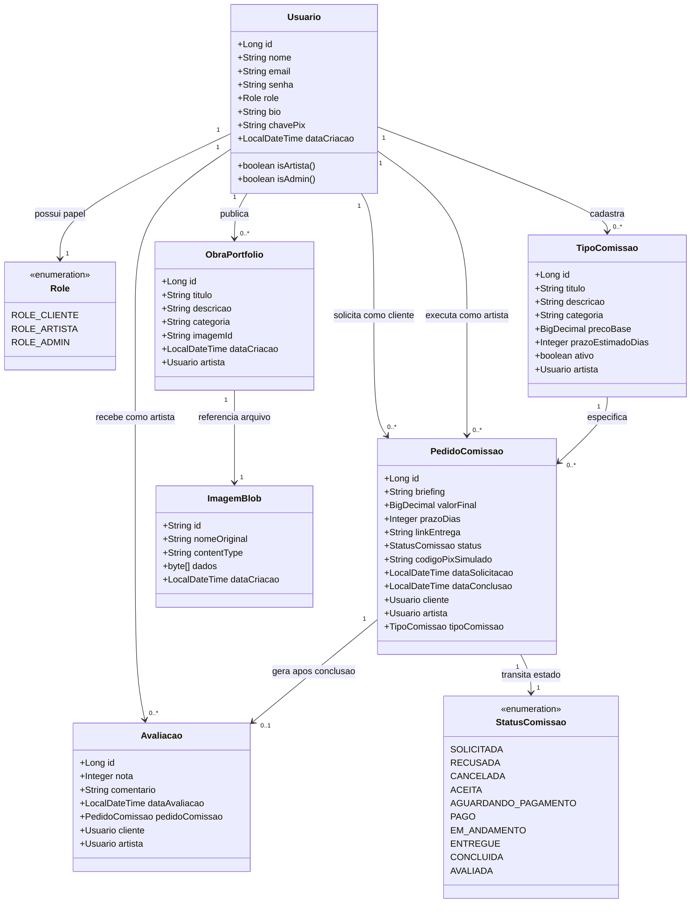

---

## 5. Detalhamento dos Fluxos por Funcionalidade

### 5.1 Funcionalidade 1: Cadastro e Autenticacao (Login e Logout)

Regra de negocio fundamental: o papel inicial (`ROLE_CLIENTE` ou `ROLE_ARTISTA`) e definido estritamente na criacao da conta. A autenticacao utiliza o mecanismo nativo de formulario do Spring Security.

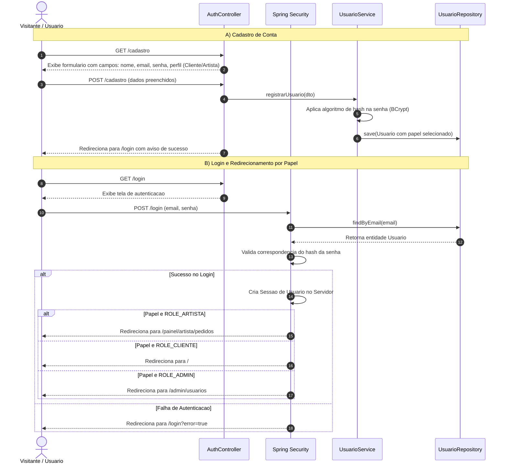

---

### 5.2 Funcionalidade 2: Promocao Administrativa de Usuario

Para mitigar alteracoes indevidas de privilegio (como mapeado nos riscos de abuso), um cliente nao pode se transformar em artista por edicao propria de perfil. Essa acao e restrita a administradores.

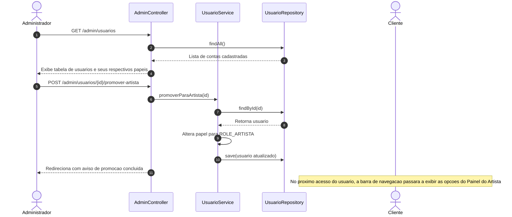

---

### 5.3 Funcionalidade 3: Catalogo, Busca Facetada e Perfil Publico

Permite a navegacao publica por visitantes e clientes, com pesquisa por categorias de ilustracao e visualizacao da bio, galeria de trabalhos e precos de comissoes.

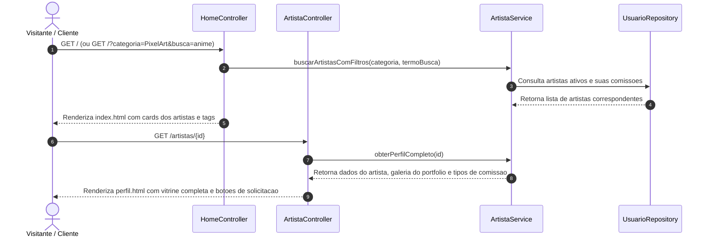

---

### 5.4 Funcionalidade 4: Gestao do Artista (Portfolio e Servicos)

Permite ao artista manter seu catalogo atualizado, publicando novas obras no portfolio com upload de imagem e cadastrando servicos com precos e prazos base.

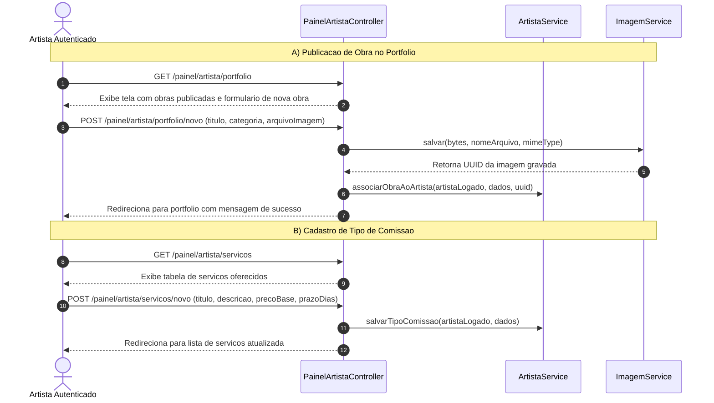

---

### 5.5 Funcionalidade 5: Ciclo de Compra e Simulacao Visual de Pagamento (PIX)

Fluxo critico de contratacao: cliente envia o briefing, artista aceita as condicoes e o sistema disponibiliza a tela visual de simulacao de pagamento.

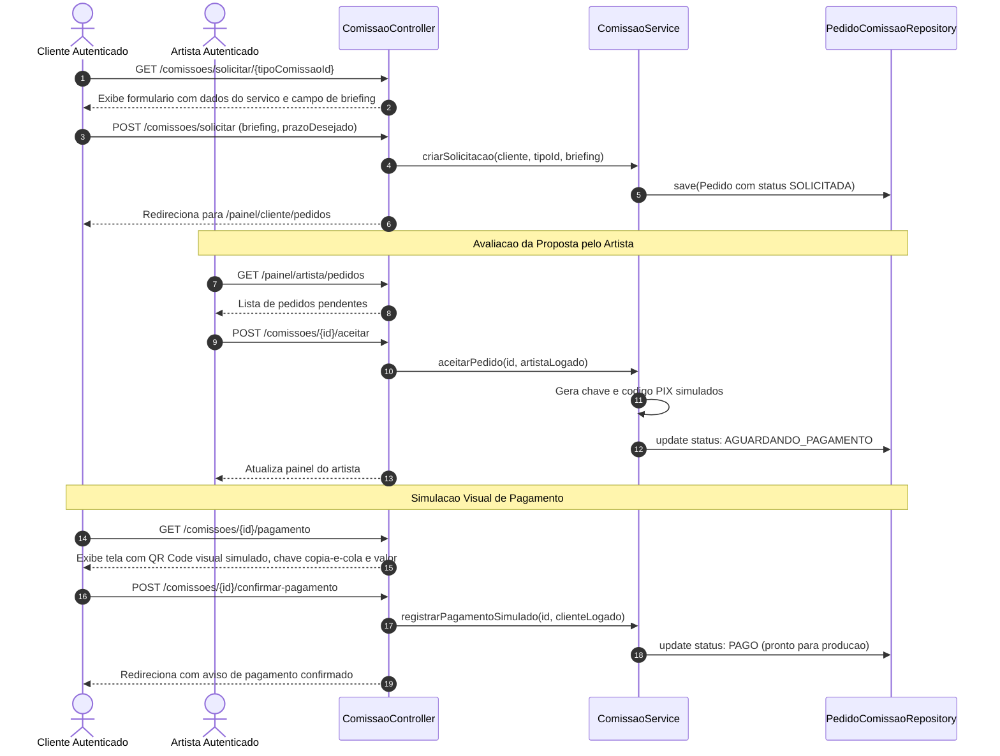

---

### 5.6 Funcionalidade 6: Entrega, Aprovacao e Avaliacao

Conclusao da encomenda: apos a producao, o artista envia o link ou entrega do trabalho, o cliente confere e aprova, habilitando o formulario de avaliacao.

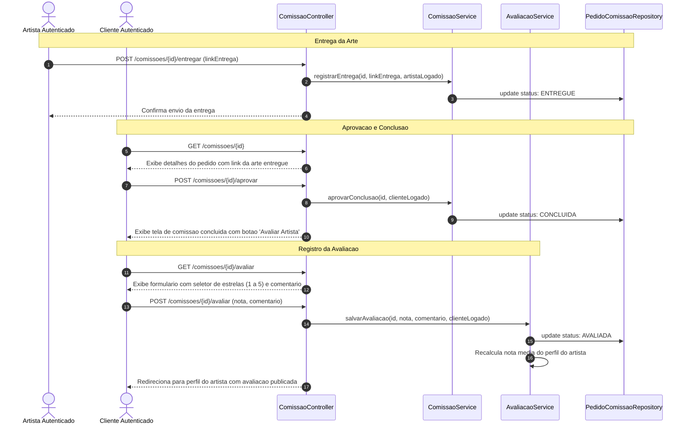

---

## 6. Diagrama de Estados do Pedido de Comissao

Mapeamento rigoroso de todas as transicoes de estado possiveis no ciclo de vida da encomenda:

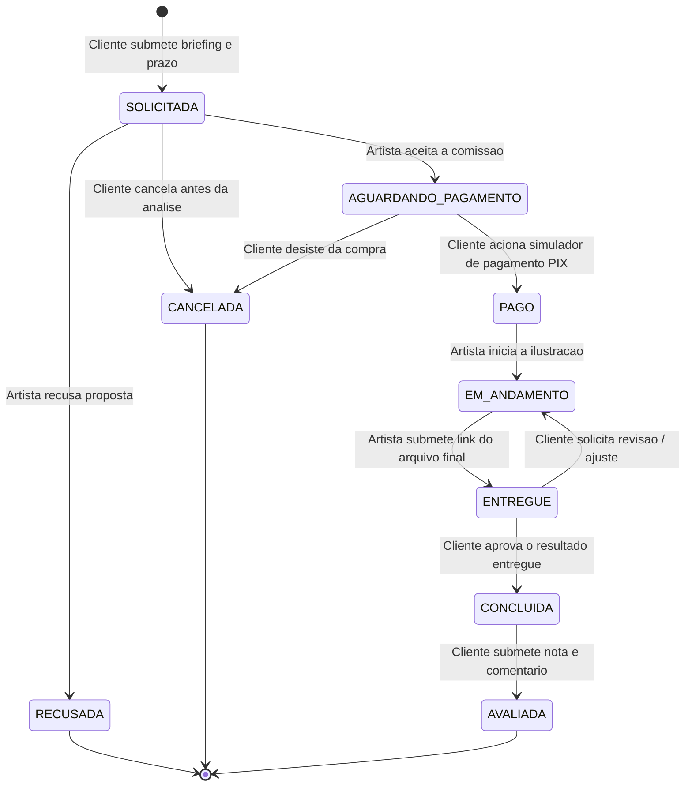

---

## 7. Mapa de Navegacao e Telas da Aplicacao

Estrutura visual das rotas e interconexoes de tela no modelo Spring MVC + Thymeleaf:

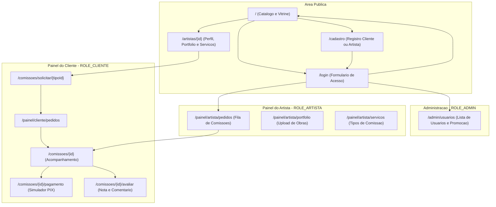

---

## 8. Roteiro de Validacao Manual do MVP

Para atestar o funcionamento correto do fluxo feliz e dos casos de uso implementados:

1. **Inicializacao da Aplicacao:**
   - Executar `./mvnw spring-boot:run` a partir da pasta `codigo/artificio`.
   - Acessar `http://localhost:8080/` e constatar a vitrine inicial populada pelos dados de exemplo da classe `DataInitializer`.

2. **Validacao de Imagens (H2 BLOB):**
   - Verificar se as imagens dos cards de artistas e obras carregam corretamente a partir das URLs `/imagens/{id}`.

3. **Cadastro e Restricao de Papel:**
   - Cadastrar um novo usuario com o perfil `CLIENTE`.
   - Tentar acessar diretamente `/painel/artista/portfolio` e confirmar que o Spring Security bloqueia com erro 403 (Acesso Negado).

4. **Ciclo Completo de Contratacao:**
   - Navegar ate o perfil de um artista cadastrado.
   - Selecionar um tipo de comissao e preencher o briefing.
   - Logar com a conta do respectivo artista, acessar a fila de pedidos e aceitar a comissao.
   - Retornar ao usuario cliente, acessar a tela de pagamento simulado e confirmar a transacao PIX.
   - Retornar ao artista, registrar a entrega da obra.
   - Retornar ao cliente, aprovar o resultado final e enviar nota e comentario de avaliacao.
   - Acessar novamente o perfil publico do artista e constatar que a avaliacao e a nota media foram computadas.

5. **Promocao de Usuario por Administrador:**
   - Logar como `admin@artificio.local`.
   - Acessar `/admin/usuarios` e promover uma conta comum de cliente para artista.
   - Deslogar, logar com a conta promovida e verificar se as opcoes de gestao de portfolio e servicos foram liberadas.
